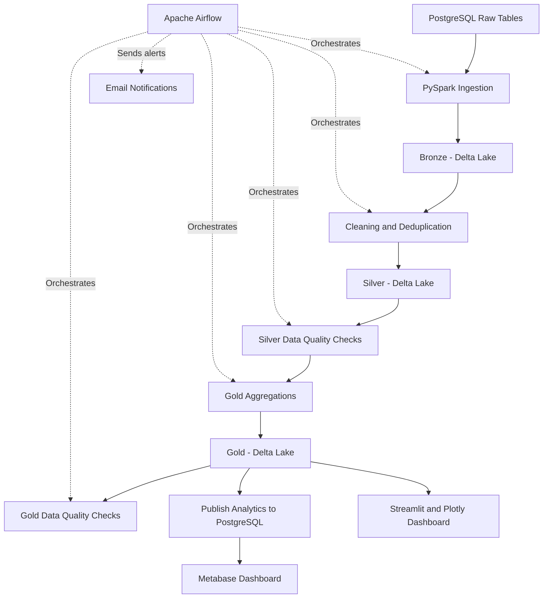

# E-commerce Data Engineering Pipeline

An end-to-end data engineering project that ingests e-commerce data from PostgreSQL, processes it using PySpark and Delta Lake, orchestrates workflows with Apache Airflow, validates data quality, and delivers analytics through Streamlit and Metabase dashboards.


## Workflow


## Architecture



## Technology Stack

- **Language:** Python
- **Data processing:** Apache Spark / PySpark
- **Storage format:** Delta Lake
- **Database:** PostgreSQL
- **Orchestration:** Apache Airflow
- **Dashboards:** Streamlit, Plotly, Metabase
- **Containerization:** Docker and Docker Compose
- **Data quality:** Custom validation scripts
- **Notifications:** SMTP email alerts

## Pipeline Workflow

1. **Ingestion:** Extract source tables from PostgreSQL into the Bronze layer.
2. **Transformation:** Clean and deduplicate records into the Silver layer.
3. **Quarantine:** Separate invalid records during data cleaning.
4. **Silver validation:** Check the quality of cleaned datasets.
5. **Aggregation:** Generate business-ready Gold datasets.
6. **Gold validation:** Validate the analytics datasets.
7. **Publishing:** Export Gold datasets into PostgreSQL for business intelligence.
8. **Visualization:** Display insights in Streamlit and Metabase.
9. **Monitoring:** Use Airflow to orchestrate tasks and send email notifications.

## Data Layers

| Layer | Purpose |
|---|---|
| Bronze | Data ingested from source PostgreSQL tables |
| Silver | Cleaned and deduplicated datasets |
| Gold | Aggregated datasets for analytics and reporting |

### Source Tables

The `raw` schema contains:

- `customers`
- `products`
- `orders`
- `order_items`
- `payments`

### Gold Datasets

The Gold datasets are published to the PostgreSQL `analytics` schema.

| Dataset | Purpose |
|---|---|
| `monthly_sales` | Monthly sales analysis |
| `product_performance` | Product-level performance metrics |
| `customer_summary` | Customer-level summary metrics |

## Airflow DAG

The `ecommerce_pipeline` DAG executes these tasks sequentially:

1. `postgres_to_bronze`
2. `bronze_to_silver`
3. `validate_silver`
4. `silver_to_gold`
5. `validate_gold`
6. `pipeline_success_summary`

Task dependencies ensure that downstream steps run only after their prerequisites succeed.

## Project Structure

```text
ecommerce-data-pipeline/
├── airflow/
│   └── dags/
│       └── ecommerce_pipeline.py
├── dashboard/
│   └── app.py
├── src/
│   ├── ingestion/
│   │   └── postgres_to_bronze.py
│   ├── transformations/
│   │   ├── bronze_to_silver.py
│   │   └── silver_to_gold.py
│   ├── data_quality/
│   │   ├── validate_silver.py
│   │   └── validate_gold.py
│   └── exports/
│       └── gold_to_postgres.py
├── data/
│   ├── bronze/
│   ├── silver/
│   ├── gold/
│   └── quarantine/
├── jars/
├── docker-compose.yml
├── .env.example
└── README.md
```

## Prerequisites

- Docker Engine and Docker Compose
- Python with `venv`
- Git
- A Java version compatible with the installed PySpark version
- PostgreSQL and Airflow configured through Docker Compose

## Configuration

Create a local environment file from the example:

```bash
cp .env.example .env
```

Configure the required PostgreSQL credentials and other project settings in `.env`.

Example placeholders:

```dotenv
POSTGRES_DB=ecommerce
POSTGRES_USER=ecommerce_user
POSTGRES_PASSWORD=replace_with_a_strong_password
POSTGRES_HOST=localhost
POSTGRES_PORT=5432
```

Configure SMTP variables if email notifications are required.

**Security:** Never commit `.env`, real passwords, SMTP credentials, private keys, or other secrets. Ensure `.env` is listed in `.gitignore`.

## Running the Project

### 1. Start the services

From the project root:

```bash
docker compose up -d
docker compose ps
```

Wait for the database and Airflow services to become healthy.

### 2. Access Airflow

Open:

http://localhost:8080

Find `ecommerce_pipeline`, enable it if necessary, and trigger a DAG run. Verify that all tasks succeed.

### 3. Run the pipeline manually (optional)

Activate the virtual environment:

```bash
source venv/bin/activate
```

Execute the scripts from the project root in pipeline order:

```bash
python src/ingestion/postgres_to_bronze.py
python src/transformations/bronze_to_silver.py
python src/data_quality/validate_silver.py
python src/transformations/silver_to_gold.py
python src/data_quality/validate_gold.py
python src/exports/gold_to_postgres.py
```

Use Airflow for normal end-to-end orchestration.

### 4. Access the Streamlit dashboard

```bash
source venv/bin/activate
streamlit run dashboard/app.py
```

Open the local URL printed in the terminal, usually:

http://localhost:8501

### 5. Access Metabase

Open:

http://localhost:3000

Connect Metabase to the PostgreSQL database using the correct Docker network settings.

| Setting | Value |
|---|---|
| Host | `postgres` when Metabase is connected to the Compose network |
| Port | `5432` |
| Database | `ecommerce` |
| Username | Your `POSTGRES_USER` value |
| Password | Your `POSTGRES_PASSWORD` value |
| Schema | `analytics` |

The `analytics` schema contains the published Gold datasets.

## Refresh Analytics Tables

After generating the Gold datasets, run:

```bash
source venv/bin/activate
python src/exports/gold_to_postgres.py
```

This refreshes the PostgreSQL analytics tables from the Gold datasets. Use it only with the intended database because the export script replaces the contents of those tables.

## Data Quality and Monitoring

- Dedicated validation scripts check Silver and Gold datasets.
- Invalid records are handled through quarantine.
- Airflow manages task dependencies and execution.
- Email notifications report pipeline success or failure when SMTP is configured.

## Future Enhancements

- Incremental ingestion and change data capture
- Automated tests and CI/CD
- Data lineage and observability
- Cloud storage and managed orchestration
- Dashboard screenshots and a project demonstration video

## Author

**Abhishek Mangalur**

Portfolio project demonstrating data ingestion, distributed processing, orchestration, data quality, and analytics.
